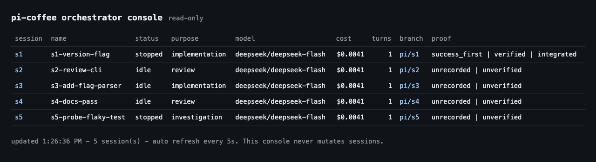

**[English](README.md) | [简体中文](README.zh-CN.md)**

# pi-coffee

An MCP server for running several pi coding agents on one repository without them stepping on each
other. Every worker gets its own git worktree and branch; the daemon keeps the file claims, the
mailbox, the shared board and an evidence trail. You stay the reviewer: nothing merges until the
exact candidate has passed a fixed acceptance command and every declared requirement has a verdict.

Any MCP client can drive it — Codex and [DeepSeek Harness](docs/integrations/dsh.md) are the
reference clients. Small fixes stay direct.

[](https://github.com/lucasjingcn/pi-coffee/actions/workflows/verify.yml)
[](https://nodejs.org)
[](LICENSE)
[](https://www.typescriptlang.org)
[](https://modelcontextprotocol.io)

## Why bother

One agent in a repository is easy to supervise. Several are not: they overwrite each other's files,
or they leave behind long-lived branches that are painful to merge. Copying the repo wastes the
parallelism; running things strictly one after another wastes your time.

pi-coffee gives every worker a private worktree and branch, makes file ownership explicit, and keeps
one supervisor responsible for the final result. When a worker finishes, you get a diff, a report, a
passing acceptance run against the exact candidate, and a merge gate that refuses anything else.

Workers are worth it for clearly scoped, independent, objectively verifiable work. They are not worth
it for a one-line repair or a tightly coupled change — do that yourself.

## Requirements

| Requirement | Notes |
|---|---|
| **Node.js ≥ 22.19** | Runtime and test suite. CI covers 22.19, 24 and 26. |
| **git** | Worktrees, diffs, merges, branch cleanup. |
| **pi** | Installed as a pinned local npm dependency. It can authenticate from an API key in the environment, so `/login` is optional. |
| **An MCP client** | Codex and DeepSeek Harness are the reference clients; any MCP-capable client works. |
| **Windows 10+** | Git for Windows with Git Bash, plus Node and the client CLI on `PATH`. |

Run the daemon, the client and the workers as the same user: they share file ownership. Root is not
required — any user with a working `pi` and write access to the repository is fine. Provider
credentials come from the generated env file or from pi's own `~/.pi/agent/auth.json`.

## Quick start

No checkout needed — the one-line installer fetches the newest release into `~/.pi-coffee/app` and runs
the same installer:

```bash
curl -fsSL https://raw.githubusercontent.com/lucasjingcn/pi-coffee/main/scripts/bootstrap.sh | bash
```

Or from a checkout:

```bash
git clone https://github.com/lucasjingcn/pi-coffee.git
cd pi-coffee
npm run install:local      # build, install the skill + pi CLI, register clients, start the daemon
```

It checks Node and git first, installs the pinned `pi` CLI and the `pi-orchestrator` skill, registers
the MCP server `pi` with every client it finds, asks for provider, API key and model
(`~/.pi-coffee/env`), and starts a per-user background daemon. No client is required up front: a
missing Codex is skipped and the summary prints the exact command for the client you do have. For a
scripted install, forward the setup options:

```bash
npm run install:local -- --provider deepseek --model deepseek-flash --api-key sk-...
```

A missing credential is a warning, not a failed install: run `npm run setup`, then the restart command
the summary printed. Then check the daemon and prove the whole loop without spending tokens:

```bash
node scripts/check-health.mjs   # the daemon is up
npm run demo                    # offline end-to-end check, a few seconds
```

Restart your MCP client afterwards; the `pi_*` tools and the orchestration policy load then. Clients
the installer cannot write (DSH, Claude Code, Cursor) are connected with
`node scripts/register-clients.mjs`, which prints the exact command or snippet.



### A first worker

With the `pi_*` tools visible, hand the client one small task and let the loop run once:

```text
In this repository spawn one pi worker:
  spec: { goal: "make the acceptance command pass for src/app.ts", scope: ["src/app.ts"],
          task_type: "mechanical", purpose: "implementation" }
  acceptance_command: "node --test tests/app.test.mjs"
Then show me pi_diff, run pi_verify, record pi_review for the requirement, pi_merge, and
pi_finish with outcome success_first.
```

## One task, end to end

1. **Spawn.** Call `pi_spawn` with a `spec` (`goal`, `scope`, `purpose`), a fixed `acceptance_command`,
   and `acceptance_files` for any independent tests. The scope is claimed before the worker starts, so
   an overlapping workstream is rejected immediately.
2. **Work.** The worker edits inside its scope in a private worktree. Questions come back through
   `coord_ask`; conflicting claims are explained instead of silently overwritten.
3. **Review.** When the worker settles, read the full `pi_diff` and commit the reviewed changes.
4. **Verify.** `pi_verify` rebuilds an isolated candidate from the exact worker and target commits and
   runs the acceptance command. Exit code, timeout, output, SHAs and tree evidence are recorded.
5. **Approve requirements.** `pi_review` records one verdict per hard requirement and one reason per
   changed existing test file, bound to that verification.
6. **Merge.** `pi_merge` refuses a changed commit, a failed or timed-out run, a dirty checkout, a scope
   violation, or a missing review. `pi_pr` and the GitHub merge queue are available when pushing is
   explicitly allowed.
7. **Close.** `pi_finish` records the outcome; `pi_report` and `pi_metrics` show what landed first
   try; `pi_gc` reclaims what is no longer needed.

## Tools

The full reference — arguments, gates, edge cases — is in
[docs/reference/tools.md](docs/reference/tools.md).

| Tool | What it does |
|---|---|
| `pi_spawn` | Create a worktree and branch, then start a worker. Returns its one-time `control_key` and a `scope_key`. |
| `pi_send` | Send an instruction (`prompt`, `steer` or `followup`) to a running worker. |
| `pi_wait` | Block for a settled worker, a question, or a new handoff notice. |
| `pi_status` | Show concise state and pending questions for one or more sessions. |
| `pi_list` | List sessions, optionally limited to the ids from this chat. |
| `pi_tail` | Read a worker transcript incrementally. |
| `pi_diff` | Show committed, uncommitted and untracked changes for a worker branch. |
| `pi_commit` | Stage and commit everything in a worker's worktree. |
| `pi_verify` | Run the acceptance command or validator chain against the exact candidate and record evidence. |
| `pi_evidence` | List, read or re-hash the durable evidence bundle written by `pi_verify`. |
| `pi_review` | Record per-requirement verdicts and approvals for changed existing tests. |
| `pi_merge` | Merge only with current passing evidence, valid scope and clean checkouts. |
| `pi_pr` | Push a verified branch and open or reuse a GitHub PR carrying the evidence summary. |
| `pi_push` | Push the current branch, or an explicit one, to a remote. |
| `pi_exec` | Run a diagnostic shell command in a worker's worktree. Never merge evidence. |
| `pi_answer` | Answer a worker's pending question. |
| `pi_stop` | Stop an unfinished worker early, optionally removing its worktree and branch. |
| `pi_resume` | Restart a stopped, unfinished worker on its own transcript instead of re-dispatching. |
| `pi_finish` | Record the outcome (`success_first`, `success_second`, `taken_over`, `abandoned`) and stop the worker. |
| `pi_report` | Outcome counts by purpose, per-task notes, cost coverage and inconsistent successes. |
| `pi_metrics` | Usage and cost evidence for active and historical sessions. |
| `pi_record_cost` | Register orchestrator cost evidence with a source and reference. |
| `pi_audit` | Verify the hash-chained audit log, or tail its newest entries. |
| `pi_claim` | Claim repository paths by hand so other workers stay out. |
| `pi_release` | Release claims held by a session. |
| `pi_locks` | List every active file claim. |
| `pi_message` | Send durable mail to a worker, with a persisted read-back receipt. |
| `pi_inbox` | Read mail addressed to a worker. |
| `pi_board_post` | Post a shared fact, decision or interface contract. |
| `pi_board_read` | Read the shared board; `latest=true` returns the newest value per key. |
| `pi_recover_control` | Recover a lost worker control key with this chat's scope key. |
| `pi_drain` | Drain the daemon before a restart; new spawns pause, running workers finish. |
| `pi_gc` | Reclaim selected stopped work, and delete only branches whose integration is proven. |

Daemon-spawned pi sessions additionally get the worker-side tools `coord_ask`, `coord_send`,
`coord_inbox`, `coord_claim`, `coord_release`, `coord_board_post`, `coord_board_read` and
`coord_status`.

## File claims

Before a worker writes, it claims the path. `edit` and `write` claim their target file; `bash` claims
the literal redirect, `tee` and `sed -i` targets it recognizes. If another worker holds a conflicting
claim, the call is blocked and the worker is told who holds it. Claims are namespaced per repository,
so two checkouts of the same repo share them and unrelated repos never collide.

Claims are coordination protection, not a sandbox: dynamic paths, variables and globs are not fully
contained, and a worker can still run arbitrary code inside its worktree. For untrusted code, use the
Docker sandbox — see [docs/reference/coordination.md](docs/reference/coordination.md).

## Configuration

Everything is set through `PI_COFFEE_*` environment variables, read from the private env file
(`~/.pi-coffee/env`) or the process environment. The ones people change most:

| Variable | Default | Meaning |
|---|---|---|
| `PI_COFFEE_PROVIDER` / `PI_COFFEE_MODEL` | `deepseek` / `deepseek-flash` | Worker provider and model. |
| `PI_COFFEE_THINKING` | `xhigh` | pi thinking level; overridable per spawn. |
| `PI_COFFEE_MAX_SESSIONS` | `8` | Hard cap on concurrent workers. |
| `PI_COFFEE_DEFAULT_REPO` | *(none)* | Repository used when `pi_spawn` omits `repo`. |
| `PI_COFFEE_DATA_DIR` | `~/.pi-coffee` | Daemon state: locks, mailbox, board, metadata, evidence, audit log. |
| `PI_COFFEE_TOKEN` | *(none)* | Shared secret for `/mcp` and `/internal/*`. |
| `PI_COFFEE_SANDBOX` | `worktree` | Execution backend: `worktree` or `docker`. |
| `PI_COFFEE_ALLOW_PUSH` | `0` | Explicit opt-in for `pi_pr` and merge-queue pushes. |
| `PI_COFFEE_WORKER_PLUGINS` | *(empty)* | Glob allowlist of global plugins a worker may inherit. |

All 50+ variables, their validation rules and the env-file precedence are in
[docs/reference/configuration.md](docs/reference/configuration.md).

## Client timeouts

`pi_verify` and `pi_exec` may run for up to 10 minutes. Most MCP clients cap a tool call at 60
seconds, so raise the limit once per client:

```toml
[mcp_servers.pi]
# ...command/args...
tool_timeout_sec = 600
```

```json
// ~/.pi/agent/mcp.json
{ "mcpServers": { "pi": { "timeout": 600 } } }
```

A client timeout cancels nothing: the worker keeps working and the evidence stays valid. Read the
real state with `pi_status` / `pi_list` instead of treating it as a failure.

## Docker

The image bundles Node, git and pi, so the only host requirement is Docker.

```bash
cp .env.example .env       # provider key and model
mkdir -p workspace         # the repository workers should edit
docker compose up -d --build
curl http://127.0.0.1:8787/internal/health
```

`./workspace` is mounted at `/workspace` and is the default repo; a named volume holds `/data`. Point
your client at `http://127.0.0.1:8787/mcp`. Details and the no-Compose invocation are in
[docs/reference/operations.md](docs/reference/operations.md#docker).

## Docs

| Document | What is in it |
|---|---|
| [docs/reference/operations.md](docs/reference/operations.md) | Install, services and logs, dashboard and metrics, upgrades, uninstall, state recovery, cleanup, security, troubleshooting. |
| [docs/reference/tools.md](docs/reference/tools.md) | Every tool with its arguments and gates. |
| [docs/reference/configuration.md](docs/reference/configuration.md) | Every environment variable. |
| [docs/reference/coordination.md](docs/reference/coordination.md) | Claims, mailbox and board receipts, chat isolation, audit log, Docker sandbox. |
| [docs/development.md](docs/development.md) | Architecture, commands, tests, docs contract, release. |
| [codex/pi-orchestrator/SKILL.md](codex/pi-orchestrator/SKILL.md) | The authoritative orchestration policy. |
| [CHANGELOG.md](CHANGELOG.md) | Release history. |

## Development

```bash
npm ci
npm run build
npm test        # build + offline suite, no credentials or network
npm run verify  # typecheck, extension typecheck, offline suite, docs contract
```

The offline suite drives the whole control surface against a fake `pi` that speaks JSONL. See
[docs/development.md](docs/development.md) for the architecture and release process.

## Security and limits

- The daemon binds to loopback with no authentication. Set `PI_COFFEE_TOKEN` before exposing it, and
  only on a trusted network.
- Claims and digest checks block mistakes and invalid integration; they are not an OS sandbox.
- A graceful daemon stop stops workers. A crash is recovered on the next start for sessions that were
  active at the time; explicitly stopped sessions are not resumed, and Windows has no automatic
  orphan-process recovery.
- The worktree model assumes one worker per branch. The same branch in two worktrees is unsupported.

## License

Apache License 2.0. See [LICENSE](LICENSE).

Copyright 2026 lucasjing.

pi (`@earendil-works/pi-coding-agent`) is a separate MIT-licensed program by Mario Zechner. This
repository invokes it as an external tool rather than redistributing its code; the Docker image
installs it from npm at build time. pi is not affiliated with, and does not endorse, this project.
