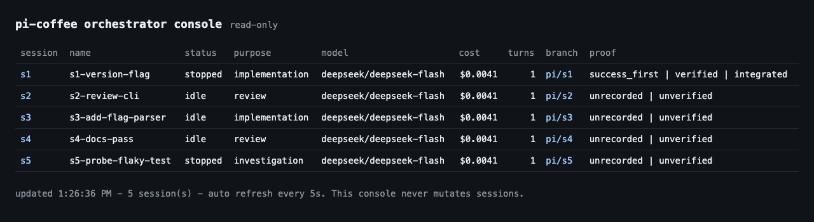

**[English](README.md) | [简体中文](README.zh-CN.md)**

# pi-coffee

一个 MCP 服务：让多个 pi 编码代理同时在同一个仓库上干活，而不互相踩脚。每个 worker 有独立的 git
worktree 和分支；daemon 负责文件声明、邮箱、共享看板，以及一条验收证据链。最终判断权在你手里：只有
精确候选跑过固定的验收命令、并且每条硬性要求都有结论，才允许合并。

任何支持 MCP 的客户端都能驱动它，Codex 和 [DeepSeek Harness](docs/integrations/dsh.md) 是参考客户端。
一行两行的修复，自己改就行。

[](https://github.com/lucasjingcn/pi-coffee/actions/workflows/verify.yml)
[](https://nodejs.org)
[](LICENSE)
[](https://www.typescriptlang.org)
[](https://modelcontextprotocol.io)

## 为什么需要它

一个代理改一个仓库，很好管。几个代理同时上就不行了：要么互相覆盖文件，要么留下一堆又长又难合的分支。
复制整个仓库会浪费并行度，把活儿全部串起来会浪费你的时间。

pi-coffee 换个做法：给每个 worker 独立的 worktree 和分支，把“谁在写哪个文件”讲明白，只留一个统筹方
对最终结果负责。worker 干完，你拿到的是 diff、报告、针对精确候选跑过的验收结果，以及一个拒绝其他
一切情况的合并门禁。

只有任务边界清楚、彼此独立、验收可以客观判定时，派发 worker 才划算。一行修复或强耦合的改动，别派，
自己改。

## 环境要求

| 要求 | 说明 |
|---|---|
| **Node.js ≥ 22.19** | 运行与测试。CI 覆盖 22.19、24、26。 |
| **git** | worktree、diff、合并、分支清理。 |
| **pi** | 作为锁定的本地 npm 依赖安装。可用环境变量里的 API key 认证，`/login` 不是必须的。 |
| **一个 MCP 客户端** | Codex 与 DeepSeek Harness 是参考客户端，其他支持 MCP 的也行。 |
| **Windows 10+** | Git for Windows（含 Git Bash），Node 和客户端 CLI 在 `PATH` 上。 |

daemon、客户端和 worker 要用同一个用户运行，它们共享文件属主。不需要 root——任何能跑 `pi`、对仓库有
写权限的用户都可以。模型凭据来自安装时生成的 env 文件，或 pi 自己的 `~/.pi/agent/auth.json`。

## 快速开始

不用先 clone：一行安装器会把最新 release 取到 `~/.pi-coffee/app`，再跑同一个安装程序。

```bash
curl -fsSL https://raw.githubusercontent.com/lucasjingcn/pi-coffee/main/scripts/bootstrap.sh | bash
```

或者从仓库里装：

```bash
git clone https://github.com/lucasjingcn/pi-coffee.git
cd pi-coffee
npm run install:local      # 构建、装技能和 pi CLI、注册客户端、启动后台 daemon
```

它先检查 Node 和 git，装好锁定的 `pi` CLI 和 `pi-orchestrator` 技能，把 MCP server `pi` 注册到它
找到的每个客户端，询问 provider、API key 和模型（写进 `~/.pi-coffee/env`），最后装好并启动当前用户的
后台 daemon。它不要求你预先装好某个客户端：没有 Codex 就跳过，并在结尾打印你手上客户端的确切接法。
脚本化安装直接把参数传进去：

```bash
npm run install:local -- --provider deepseek --model deepseek-flash --api-key sk-...
```

暂时没有凭据只是警告，不会让安装失败：跑一次 `npm run setup`，再执行结尾打印的重启命令。之后确认
daemon 起来了，并顺手把整条链路无成本跑一遍：

```bash
node scripts/check-health.mjs   # daemon 已启动
npm run demo                    # 离线端到端检查，几秒钟，不调用模型
```

然后重启 MCP 客户端，`pi_*` 工具和编排策略才会加载。安装器写不了的客户端（DSH、Claude Code、
Cursor）用 `node scripts/register-clients.mjs` 连接，它会打印确切命令或配置片段。



### 第一个 worker

`pi_*` 工具出来以后，给客户端丢一个小任务，完整走一遍循环：

```text
在这个仓库里派一个 pi worker：
  spec: { goal: "让 src/app.ts 的验收命令通过", scope: ["src/app.ts"],
          task_type: "mechanical", purpose: "implementation" }
  acceptance_command: "node --test tests/app.test.mjs"
然后给我看 pi_diff，跑 pi_verify，为要求记录 pi_review，pi_merge，最后 pi_finish success_first。
```

## 一个任务的全过程

1. **派发。** 调用 `pi_spawn`，带上 `spec`（`goal`、`scope`、`purpose`）、固定的 `acceptance_command`，
   需要独立测试时用 `acceptance_files`。范围在 worker 启动前就被声明，重叠的工作流直接拒绝。
2. **干活。** worker 在自己的 worktree 里、按范围修改。疑问走 `coord_ask`；文件声明冲突会被告知是谁占着，
   不会静默覆盖。
3. **审查。** worker 停下来后，读完整 `pi_diff`，按授权提交已审查的改动。
4. **验收。** `pi_verify` 用精确的 worker 提交和目标提交重建隔离候选，跑验收命令，记录退出码、超时、
   输出、提交 SHA 和候选树证据。
5. **逐条确认。** `pi_review` 为每条硬性要求记录结论，为每个被改动的既有测试记录批准理由，绑定到那次
   验收。
6. **合并。** `pi_merge` 会拒绝：提交变了、验收失败或超时、工作树脏、越范围改动、缺少审查。显式允许
   推送时可以用 `pi_pr` 和 GitHub merge queue。
7. **收尾。** `pi_finish` 记录结局；`pi_report` 和 `pi_metrics` 看一次做对的比例和成本；`pi_gc` 回收
   不再需要的资源。

## 工具

完整参数、门禁和边界情况见 [docs/reference/tools.md](docs/reference/tools.md)。

| 工具 | 作用 |
|---|---|
| `pi_spawn` | 建 worktree 和分支，启动 worker，返回一次性 `control_key` 和 `scope_key`。 |
| `pi_send` | 给运行中的 worker 发指令（`prompt`、`steer` 或 `followup`）。 |
| `pi_wait` | 阻塞等待 worker 停下、提出疑问，或出现新的交接通知。 |
| `pi_status` | 查看一个或多个会话的简明状态和待回答的问题。 |
| `pi_list` | 列出会话，可限定为本聊天自己的 session id。 |
| `pi_tail` | 增量读取 worker 转录。 |
| `pi_diff` | 查看 worker 分支已提交、未提交和未跟踪的改动。 |
| `pi_commit` | 提交 worker worktree 里的全部改动。 |
| `pi_verify` | 针对精确候选跑验收命令或校验链，并记录证据。 |
| `pi_evidence` | 列出、读取或重新校验 `pi_verify` 写下的证据包。 |
| `pi_review` | 记录逐条要求的结论，以及既有测试改动的批准理由。 |
| `pi_merge` | 只有当前有效证据、范围合规、工作树干净时才合并。 |
| `pi_pr` | 推送已验证分支，创建或复用带证据摘要的 GitHub PR。 |
| `pi_push` | 推送当前分支或指定分支到远端。 |
| `pi_exec` | 在 worker worktree 里跑诊断命令，永远不算合并证据。 |
| `pi_answer` | 回答 worker 待处理的问题。 |
| `pi_stop` | 提前停止未完成的 worker，可选择删除 worktree 和分支。 |
| `pi_resume` | 用原有转录恢复已停止但未完成的 worker，而不是重新派发。 |
| `pi_finish` | 记录结局（`success_first`、`success_second`、`taken_over`、`abandoned`）并停止 worker。 |
| `pi_report` | 按用途统计结局、每任务备注、成本覆盖和“声称成功但无证据”的项。 |
| `pi_metrics` | 活动与历史会话的用量和成本证据。 |
| `pi_record_cost` | 登记统筹方的成本证据，含来源与引用。 |
| `pi_audit` | 校验哈希链审计日志，或读取最新条目。 |
| `pi_claim` | 手工声明仓库路径，阻止其他 worker 写入。 |
| `pi_release` | 释放某个会话持有的声明。 |
| `pi_locks` | 列出所有生效的文件声明。 |
| `pi_message` | 给 worker 发持久消息，返回基于落盘状态的读取回执。 |
| `pi_inbox` | 读取发给 worker 的消息。 |
| `pi_board_post` | 发布共享的事实、决定或接口约定。 |
| `pi_board_read` | 读取共享看板；`latest=true` 每个 key 只取最新值。 |
| `pi_recover_control` | 持有本聊天 `scope_key` 时恢复丢失的 worker 控制键。 |
| `pi_drain` | 重启前排空 daemon：暂停新派发，运行中的 worker 自然结束。 |
| `pi_gc` | 回收选定的已停止工作，只删除已证明合并的分支。 |

daemon 启动的 pi 会话另外还会拿到 worker 端工具：`coord_ask`、`coord_send`、`coord_inbox`、
`coord_claim`、`coord_release`、`coord_board_post`、`coord_board_read`、`coord_status`。

## 文件声明

worker 写文件之前先声明。`edit` 和 `write` 声明目标文件；`bash` 声明确认到的字面重定向、`tee` 和
`sed -i` 目标。若别的 worker 持有冲突声明，这次调用会被挡住，并告诉它是谁占着。声明按仓库做命名空间，
同一仓库的两个检出共享，不同仓库即使文件名相同也不会冲突。

声明是协作保护，不是沙箱：动态路径、变量和 glob 无法完全兜住，worker 仍能在自己的 worktree 里运行任意
代码。要处理不可信代码，用 Docker 沙箱，细节见
[docs/reference/coordination.md](docs/reference/coordination.md)。

## 配置

所有配置都是 `PI_COFFEE_*` 环境变量，从私有 env 文件（`~/.pi-coffee/env`）或进程环境读取。最常改的：

| 变量 | 默认值 | 含义 |
|---|---|---|
| `PI_COFFEE_PROVIDER` / `PI_COFFEE_MODEL` | `deepseek` / `deepseek-flash` | worker 的 provider 和模型。 |
| `PI_COFFEE_THINKING` | `xhigh` | pi 思考等级，可按 spawn 覆盖。 |
| `PI_COFFEE_MAX_SESSIONS` | `8` | 并发 worker 硬上限。 |
| `PI_COFFEE_DEFAULT_REPO` | *(无)* | `pi_spawn` 未传 `repo` 时使用的仓库。 |
| `PI_COFFEE_DATA_DIR` | `~/.pi-coffee` | daemon 状态：锁、邮箱、看板、元数据、证据、审计日志。 |
| `PI_COFFEE_TOKEN` | *(无)* | `/mcp` 和 `/internal/*` 的共享密钥。 |
| `PI_COFFEE_SANDBOX` | `worktree` | 执行后端：`worktree` 或 `docker`。 |
| `PI_COFFEE_ALLOW_PUSH` | `0` | 显式允许 `pi_pr` 和 merge queue 推送。 |
| `PI_COFFEE_WORKER_PLUGINS` | *(空)* | worker 可继承的全局插件 glob 白名单。 |

全部 50 多个变量、校验规则和 env 文件优先级见
[docs/reference/configuration.md](docs/reference/configuration.md)。

## 客户端超时

`pi_verify` 和 `pi_exec` 最长可能跑 10 分钟。多数 MCP 客户端默认把单次工具调用卡在 60 秒，所以要按客户端
改一次上限：

```toml
[mcp_servers.pi]
# ...command/args...
tool_timeout_sec = 600
```

```json
// ~/.pi/agent/mcp.json
{ "mcpServers": { "pi": { "timeout": 600 } } }
```

客户端超时不会取消任何东西：worker 继续跑，证据继续有效。用 `pi_status` / `pi_list` 读真实状态，别把它
当成失败。

## Docker

镜像自带 Node、git 和 pi，宿主机只需要 Docker。

```bash
cp .env.example .env       # provider key 和模型
mkdir -p workspace         # 放 worker 要改的仓库
docker compose up -d --build
curl http://127.0.0.1:8787/internal/health
```

`./workspace` 挂到 `/workspace`，并作为默认仓库；具名卷存 `/data`。客户端指向
`http://127.0.0.1:8787/mcp`。不用 Compose 的命令在
[docs/reference/operations.md](docs/reference/operations.md#docker)。

## 文档

| 文档 | 内容 |
|---|---|
| [docs/reference/operations.md](docs/reference/operations.md) | 安装、服务与日志、Dashboard 与指标、升级、卸载、状态恢复、清理、安全、排错。 |
| [docs/reference/tools.md](docs/reference/tools.md) | 每个工具的参数和门禁。 |
| [docs/reference/configuration.md](docs/reference/configuration.md) | 全部环境变量。 |
| [docs/reference/coordination.md](docs/reference/coordination.md) | 文件声明、邮箱与看板回执、聊天隔离、审计日志、Docker 沙箱。 |
| [docs/development.md](docs/development.md) | 架构、命令、测试、文档契约、发布。 |
| [codex/pi-orchestrator/SKILL.md](codex/pi-orchestrator/SKILL.md) | 权威的编排策略。 |
| [CHANGELOG.md](CHANGELOG.md) | 版本历史。 |

## 开发

```bash
npm ci
npm run build
npm test        # 构建 + 离线测试，不需要凭据和网络
npm run verify  # 类型检查、扩展类型检查、离线测试、文档契约
```

离线测试用一个会说 JSONL 的假 `pi` 驱动整个控制面。架构和发布流程见
[docs/development.md](docs/development.md)。

## 安全与边界

- daemon 默认只监听回环、不带认证。对外暴露之前先设 `PI_COFFEE_TOKEN`，并且只在可信网络里暴露。
- 文件声明和摘要校验挡的是失误和无效集成，不是操作系统沙箱。
- 正常停止 daemon 会停掉 worker；崩溃后下次启动会恢复当时活动的会话。显式停止的会话不会恢复，Windows
  没有自动的孤儿进程恢复。
- worktree 模型假设一个分支一个 worker。把同一分支塞进两个 worktree 不在支持范围内。

## 许可证

Apache License 2.0，见 [LICENSE](LICENSE)。

版权所有 2026 lucasjing。

pi（`@earendil-works/pi-coding-agent`）是 Mario Zechner 的独立 MIT 项目。本仓库只是把它当作外部程序
调用，不再分发其代码；Docker 镜像在构建时从 npm 安装它。pi 与本项目没有隶属关系，也不为本项目背书。
