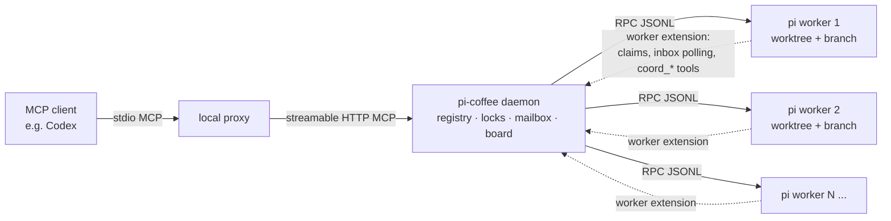

# Development

## How it fits together



The daemon is a small Node process that exposes an MCP endpoint over HTTP and an internal HTTP API.
When a client calls `pi_spawn`, the daemon creates a worktree, starts `pi --mode rpc` as a child
process, and injects a worker-side extension into it. That extension enforces file claims, polls the
mailbox, and provides the `coord_*` tools inside the worker.

Workers talk to the daemon over JSONL lines on stdin/stdout. For a local install, the client uses a
stdio proxy that reads the same configuration file as the daemon and forwards MCP requests over HTTP.
The daemon runs the pinned local pi CLI instead of importing pi's internal modules.

## Commands

```bash
npm ci                 # install (Node >= 22.19)
npm run build          # compile TypeScript to dist/
npm run setup          # write provider credentials to ~/.pi-coffee/env
npm run doctor         # check node/git/pi/credentials/data directory
npm run dev            # run the daemon from source with tsx
npm run typecheck      # main sources
npm run typecheck:extensions   # extension against the real pi API types
npm test               # build, then run the offline test suite
npm run verify         # typecheck + typecheck:extensions + offline tests
node scripts/sync-playbook.mjs --check  # after build: canonical skill/runtime/installer consistency
./smoke.sh             # full end-to-end smoke (a couple of tiny live model calls)
SMOKE_LIVE=0 ./smoke.sh   # deterministic smoke only, no model calls
```

`npm test` compiles the sources and runs everything under `tests/`. The offline smoke test builds a
throwaway git repository and daemon and drives the whole control surface — spec validation, the
task-type gate, scope overlap, test-first acceptance, diffing, model overrides, the two-strikes gate,
finishing and reporting, and restart persistence — against a fake `pi` that speaks JSONL, so it needs
no credentials and no network.

GitHub Actions runs `npm ci` and `npm run verify` on Linux and macOS with Node 22.19.0, 24 and 26. A
separate Windows job builds, type-checks, starts the daemon with an isolated setup file, and parses
the PowerShell installers. Read the workflow run itself before trusting a Windows claim: the
configuration alone does not prove an installation works. The pinned pi dependency is also the
default local worker CLI. CI does not log in to or call a model provider.

## Docs contract

`tests/docs-consistency.test.mjs` enforces the documentation contract:

- every MCP tool in `MCP_TOOL_ORDER` appears in the tool tables of `docs/reference/tools.md` and both
  READMEs;
- every `PI_COFFEE_*` name in `src/config.ts` appears in `docs/reference/configuration.md`;
- the client-timeout snippets (`tool_timeout_sec = 600`, `"timeout": 600`) stay in both READMEs;
- every relative link in the READMEs and under `docs/` resolves to a file that exists;
- both READMEs stay under a line cap, so detail belongs in `docs/` instead of growing the front page.

Add new detail to the relevant `docs/reference/` page and keep the README an index of the first five
minutes.

## Orchestration policy

The orchestration policy lives only in `codex/pi-orchestrator/SKILL.md`: the runtime prompt loads its
body and the installer copies the same file into the Codex skill directory and the shared
`~/.agents/skills` location. Keep `codex/` with `src/` and `dist/` in deployments. Rerunning
`npm run install:local` after workers finish updates the installed skill and background startup;
restart the client to load the updated policy.

## Repository layout

```
src/               daemon, MCP server, git plumbing, locks, state store
extensions/        worker-side pi extension (claims, inbox, coord_* tools)
tests/             offline test suite (node --test)
scripts/           setup, startup, health, smoke, and status helpers
deploy/            systemd, launchd, and Windows task installers
codex/             orchestrator skill installed by npm run install:local (Codex + ~/.agents/skills)
docs/              reference and operations docs, plans, research notes
Dockerfile         image with Node, git, and pi bundled
docker-compose.yml host-facing compose file
.env.example       provider key / model template for Docker
```

## Roadmap and plans

The P0/P1 hardening line — durable evidence bundles, validator chains, sandboxed workers, receipted
coordination with a hash-chained audit log, pluggable runners with ACP support, PR and merge-queue
integration, dashboard actions, dependency-aware spawns, and MCP surface hardening — is designed in
[plans/p0-p1-development.md](plans/p0-p1-development.md) and sequenced in
[plans/p0-p1-implementation.md](plans/p0-p1-implementation.md). Every item is opt-in; the
default daemon behavior stays unchanged.

## Release

Cutting a release is one reviewed commit plus a tag push; the tag build publishes it.

1. Bump `version` in `package.json` and add the matching entry to `CHANGELOG.md` in the same reviewed
   commit.
2. Run `npm run release -- --check` to confirm the version maps to `v<version>`, then `npm run release`.
   It refuses a dirty working tree or an existing tag, runs `npm run verify`, and creates the annotated
   tag. It never pushes, publishes, or changes the version.
3. `git push origin v<version>` triggers `.github/workflows/release.yml`, which runs the full verify
   suite, attaches the `npm pack` tarball to a GitHub release with generated notes, and pushes the
   container image as `ghcr.io/lucasjingcn/pi-coffee:v<version>` and `:latest`.
